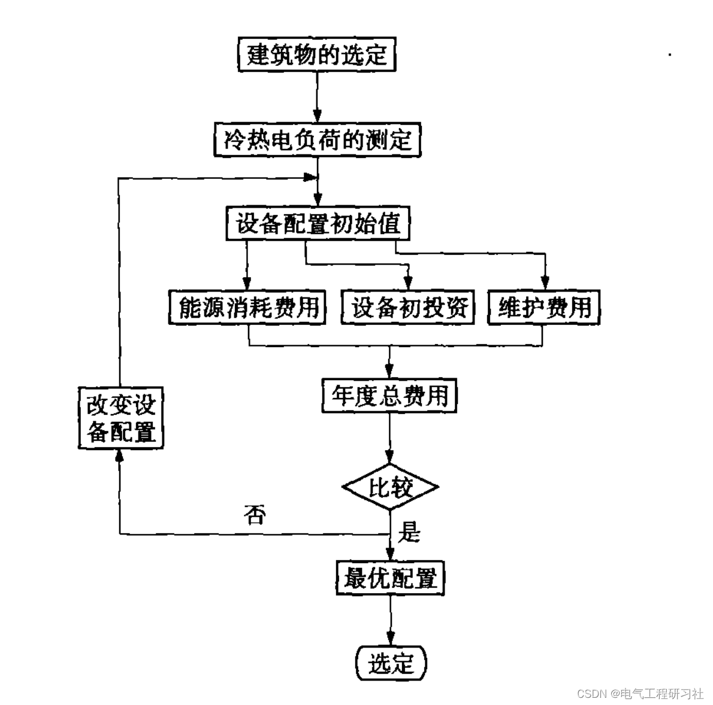
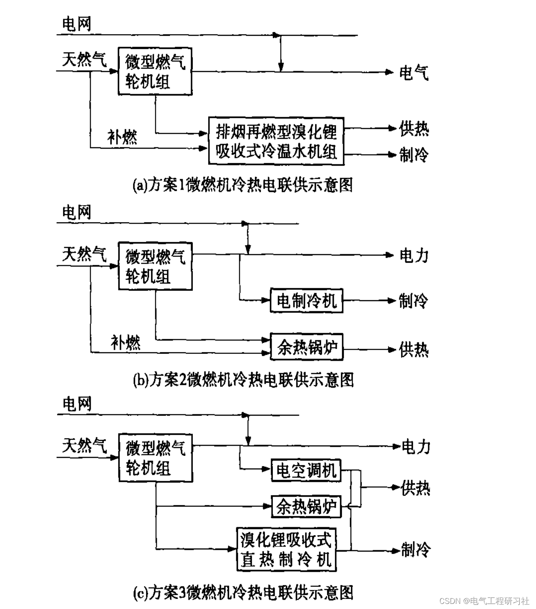
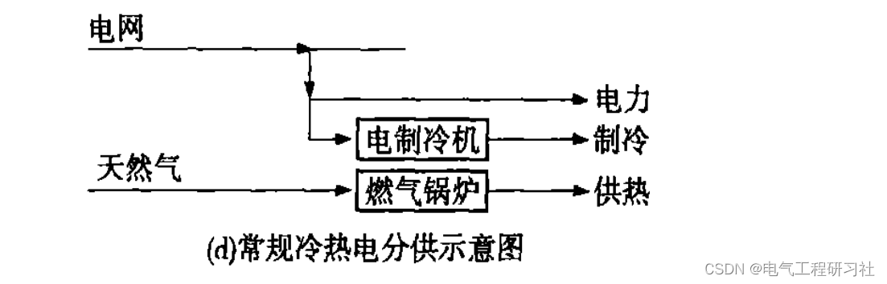
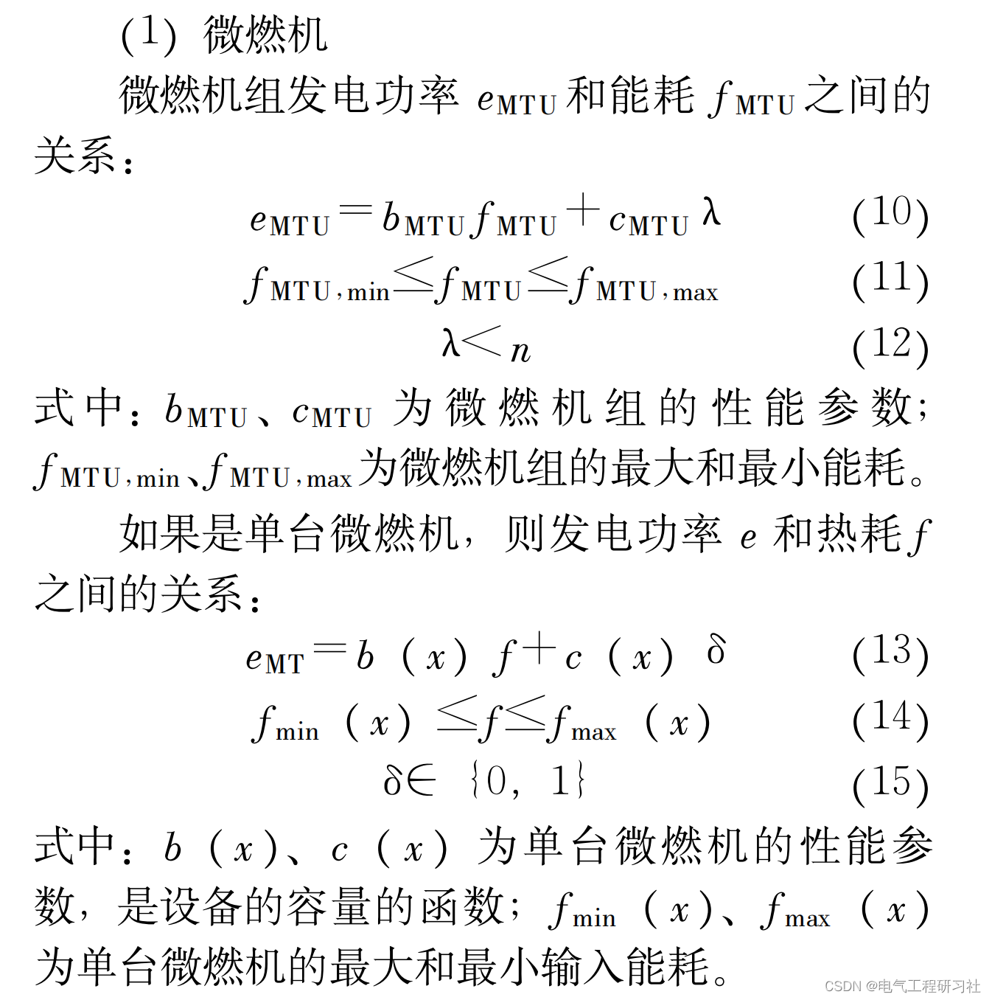
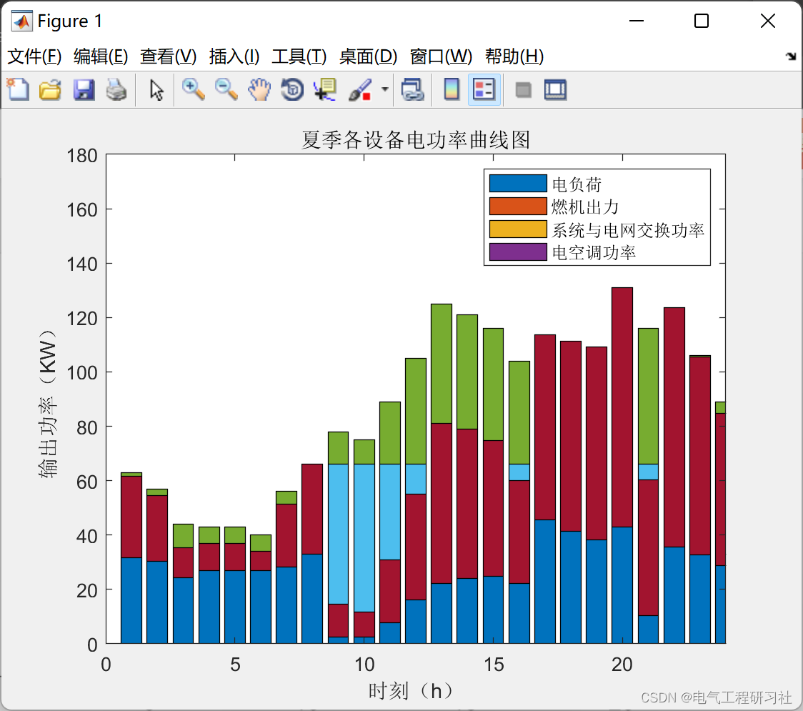
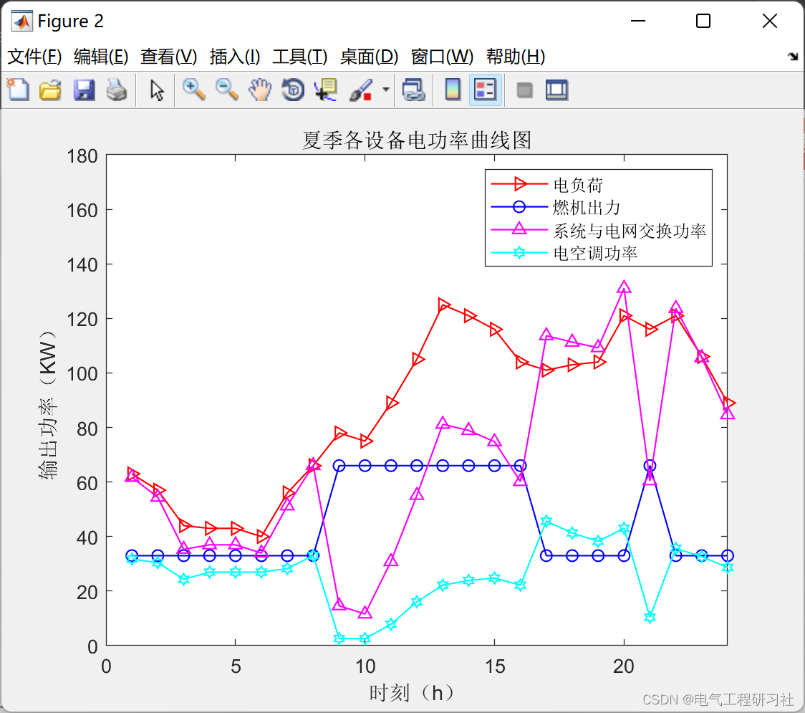
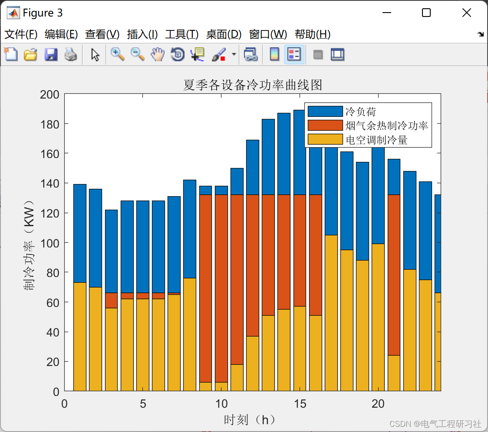
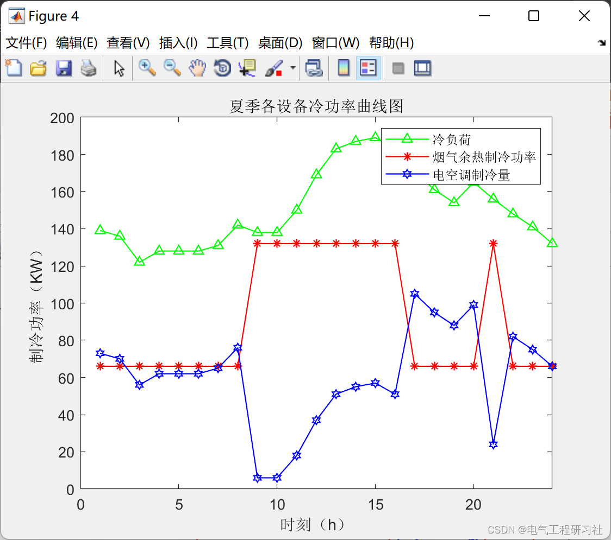
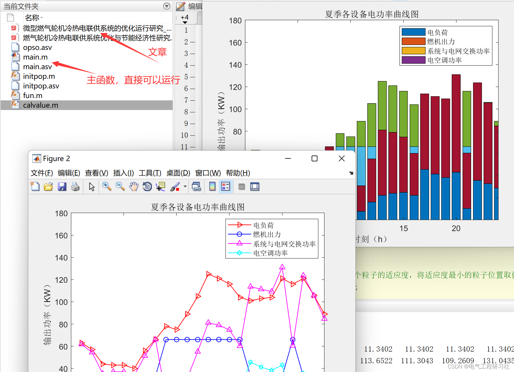

# Optimization Dispatch of Micro-Turbine Cogeneration System Based on Particle Swarm Optimization Algorithm (Matlab Code Implementation)

​  
1. Overview of Micro-Turbine Technology
This paper addresses the issue of electricity and cooling loads, selecting summer typical days. It takes into account the outputs of gas turbines and steam turbines, as well as electricity purchased from the grid. The objective function is the minimum daily operating cost of a combined heat and power system. The solution algorithm employs the Particle Swarm Optimization (PSO) method, which optimizes the dispatching of a micro-gas turbine combined heat and power system based on PSO. 2 Recapitulation: Improved Genetic and Particle Swarm Algorithms for Economical Dispatch of Cogeneration
Considering the step-up carbon trading mechanism and the comprehensive energy system of hydrogen production by electricity (Matlab code implementation)
Microgrid scheduling based on genetic algorithm (wind, solar power, batteries, micro-gas turbine) (Matlab code implementation)
Coordinated Optimization of Electrical Equipment Comprehensive Energy System Considering Uncertainty of New Energy Generation (Matlab Code Implementation)
MATLB|Intelligent Microgrid Scheduling Based on Particle Swarm Optimization Algorithm (including wind, solar, micro-turbine, grid input microgrid, energy storage)
3. Optimization Operation Steps for the Cogeneration System of Micro-Gas Turbine and Heat-Cooling
This article mainly optimizes the annual operational costs of a cogeneration system, which includes annual operational energy consumption costs, initial investment equivalent costs per year, and annual maintenance costs (including personnel expenses). The initial investment and maintenance costs are considered functions of the equipment capacity, while the annual operational energy consumption costs are the annual electricity and gas fees incurred. The constraints mainly consider the performance characteristics of each component of the system and the overall energy flow balance of the system. The energy load demand satisfied by the cogeneration system is not only selected as the demand object for daily time-series loads during the whole year but also includes the maximum load at peak times in summer and winter, as well as the annual load. Typical daily load and maximum daily load are used to determine the capacity of each configuration of the system, while the annual load is used for economic analysis [3]. The optimization goal is to minimize the annual costs of the entire system; it aims to approach the target by changing the assignment of equipment configurations.

Editor
Figure 1: Optimization Configuration Process Diagram of Micro-Gas Turbine Cogeneration System
The micro-gas turbine generates electricity and supplies power using natural gas combustion. Scheme 1 involves a combination of a micro-gas turbine unit and an exhaust reburn type cold and warm water chiller. After generating electricity with the micro-gas turbine, the high-temperature flue gas is sent to the exhaust reburn type lithium bromide absorption chiller. Depending on the season, the excess heat or cooling capacity that is insufficient for heating or cooling is obtained from natural gas supplemental combustion.

Editor
5.1 Objective Function of Optimized Operation Analysis
5.2 Constraint Conditions
Details can be found in Part 7 and References.

6 Example and Operational Results
Editor

Editor

Editor

7 MATLAB Code and Article Explanation
This article only displays part of the code, all codes can be found in:

8 References
[1] Xiong Junhua, Chen Yanhua. Research on Optimized Configuration of Cogeneration Systems Based on Gas Turbines [J]. Energy Conservation, 2017, 36(09):48-52.
[2] Zhang Junli. Research on the integrated optimization and dynamic operation rules of micro gas turbine cogeneration systems [D]. Southeast University, 2015.

[3] Wei Bing, Wang Zhiwei, Jiang Lu, Li Li. Optimization of the operation of micro gas turbine cogeneration systems [J]. Journal of North China Electric Power University (Natural Science Edition), 2007(02):138-144.

[4] Wei Bing, Wang Zhiwei, Li Li, Jiang Lu. Study on the optimization operation of micro gas turbine and cogeneration systems [J]. Shanxi Energy and Energy Conservation, 2006(04):29-30.

[5] Kong Xiangqiang, Li Ying, Wang Ruzhu, Huang Xinghua. Research on the optimization of gas turbine cogeneration systems and economical efficiency [J]. Heating, Ventilation, and Air Conditioning, 2005(07):4-8.

[6] End of the Notes

## Images

<!-- PAYMENT_BLOCK -->

## Get this dataset

- Payment link (Stripe): [Buy now](https://buy.stripe.com/3cs8yP7sY87d0vu9AB)
- Payment QR code: 

<!-- /PAYMENT_BLOCK -->
